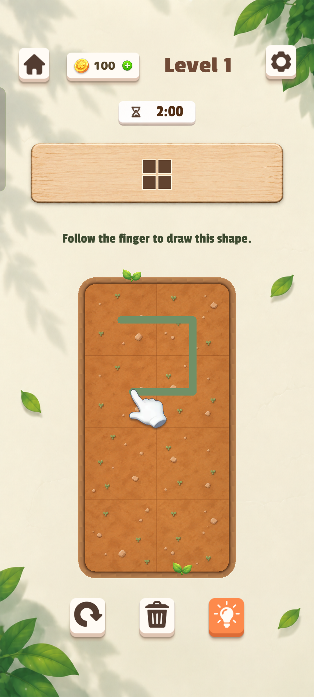
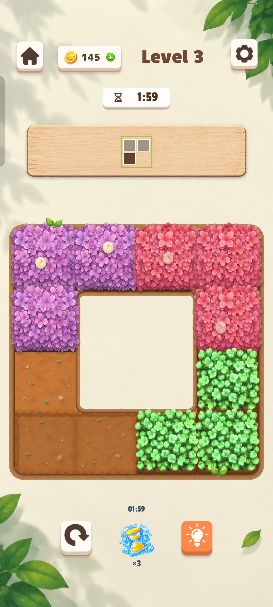
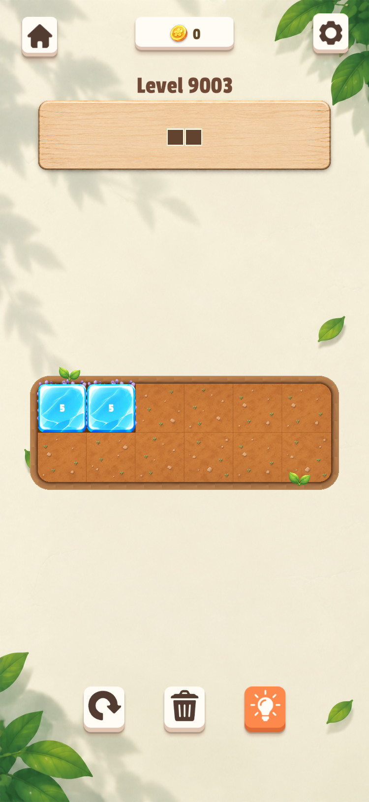
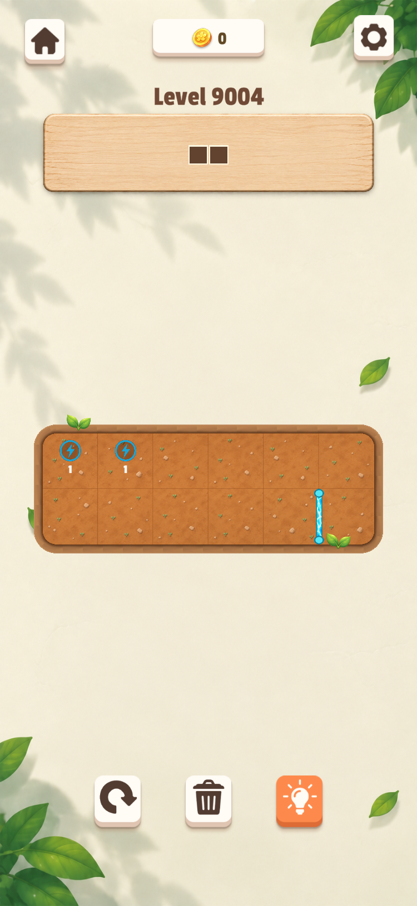
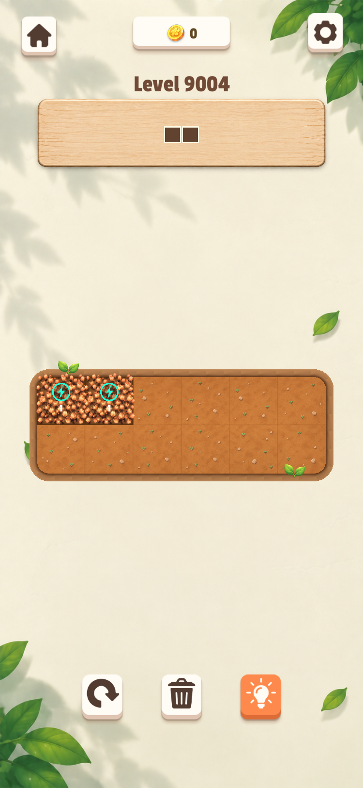
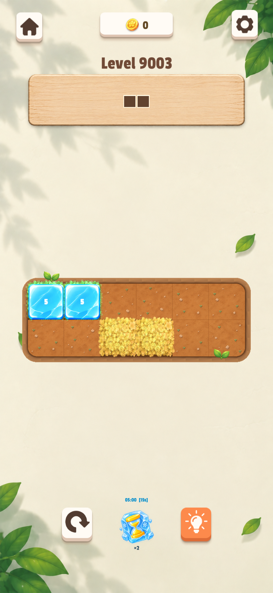

# 游戏截图与内容标注

整理日期：2026-10-22。共 6 张：2 张安卓实机截图、4 张 Unity 运行验证截图。

本次未连接安卓设备，使用此前已保存的截图，未将旧图描述为本次新拍。安卓截图来自 2026-10-22 手机验证记录（PEQM00，测试包 1.0.1 (98)）；Unity 图片为既有机制验证场景，不能替代手机端开关门验证。标注以实际画面为准。

## 安卓实机 · 第 1 关教学与整体画风

展示奶白背景、木质目标板、泥土棋盘、绿叶装饰和教学手势，是新增机制应匹配的画风基准。

## 安卓实机 · 花块与冻时道具

画面实际显示 Level 3，展示紫/红/绿花块及底部冻时沙漏 ×3。原文件名虽含 gm131，但不能据此标为第 131 关或机关门实测。

## Unity 运行验证 · 冰冻花块

Level 9003：左上两格覆盖蓝色冰壳，各显示 5 秒。观察冰壳亮度、遮挡花色，以及每格重复倒计时。

## Unity 运行验证 · 机关门关闭

Level 9004：左上两个闪电端子未接通；右下竖向电光门栏可见，表示阻断。

## Unity 运行验证 · 机关门开启

Level 9004：左上花块连接两个端子，端子变为青绿色；右下原门栏位置已隐藏。与上一张成对比较。

## Unity 运行验证 · 冻时道具与冰冻块并存

Level 9003：底部沙漏显示 ×2 和 05:00 [15s]；左上花块显示冰冻数字 5。两套计时属于不同机制，本图仅证明该显示状态，不单独证明计时过程。

